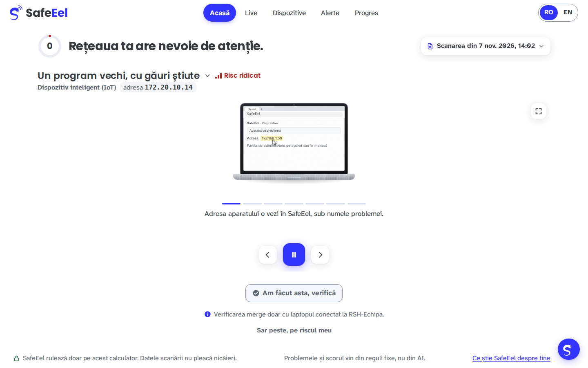
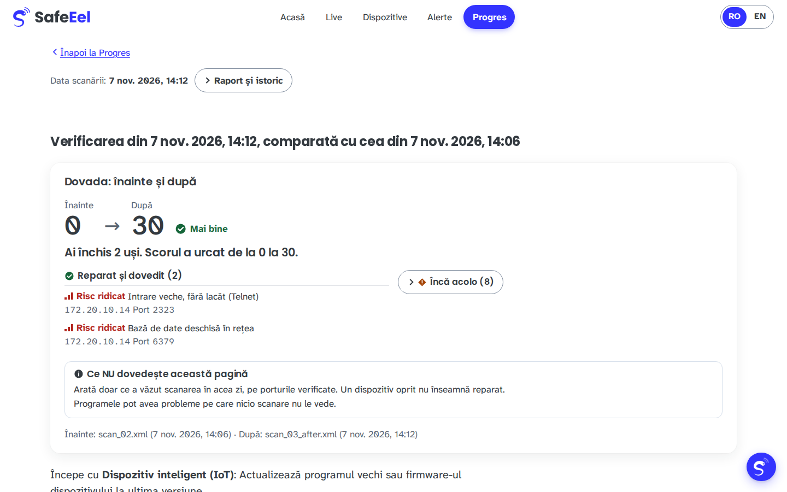
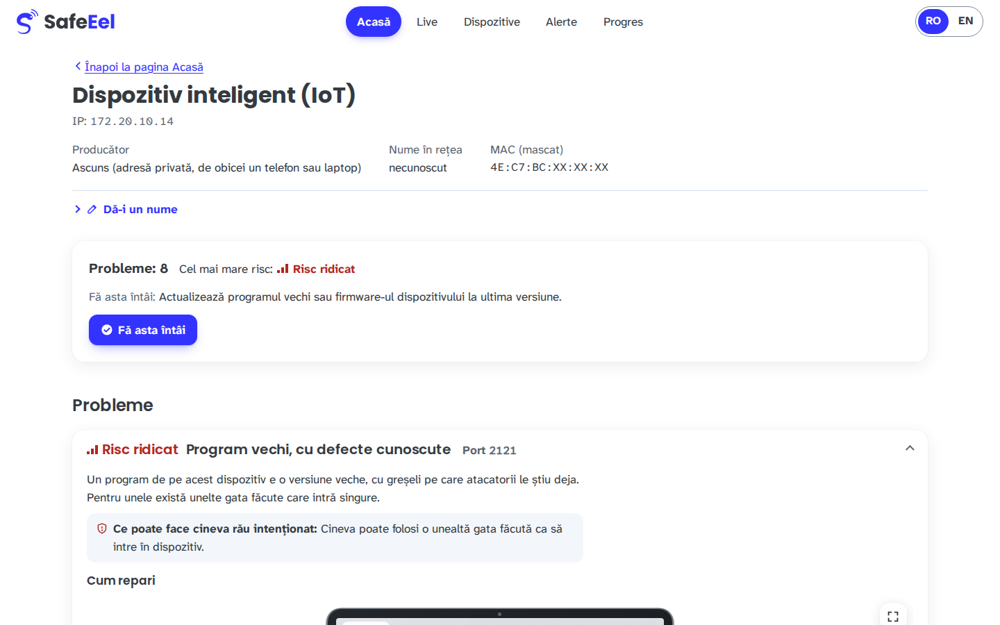
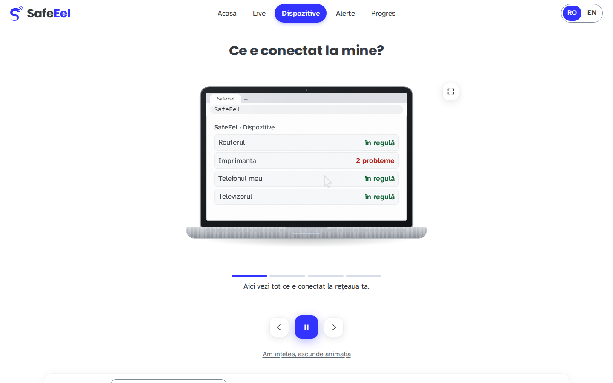
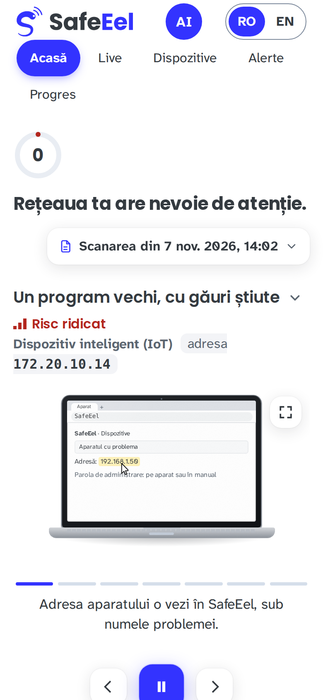
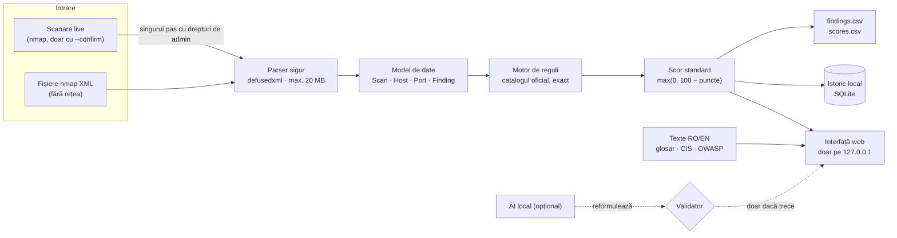

<div align="center">


### Rețeaua ta, pe înțeles.

Un verificator de securitate pentru rețeaua de acasă sau de la birou, făcut pentru oameni care nu sunt specialiști.
Află ce e conectat, ce uși sunt deschise, ce înseamnă asta și ce faci întâi, pas cu pas, cu dovada că ai reparat.


*R Systems Hackathon 2026 · Secure Networks, Simply Explained*

</div>

<p align="center">
  
</p>

> [!IMPORTANT]
> **Codul decide, modelul formulează, codul verifică.** Problemele, gravitatea lor și scorul vin numai din reguli fixe, la fel la fiecare rulare. Inteligența artificială (opțională și doar locală) poate cel mult să reformuleze un text, iar un validator respinge orice informație care nu există în scanare.

---

## Cuprins

- [De ce SafeEel](#de-ce-safeeel)
- [Ce face](#ce-face)
- [Cum arată](#cum-arată)
- [Cum funcționează](#cum-funcționează)
- [Catalogul de probleme și scorul](#catalogul-de-probleme-și-scorul)
- [Instalare](#instalare)
- [Pornire rapidă](#pornire-rapidă)
- [Comenzi](#comenzi)
- [Scanarea live, în siguranță](#scanarea-live-în-siguranță)
- [Configurare](#configurare)
- [Confidențialitate și securitate](#confidențialitate-și-securitate)
- [AI local (opțional)](#ai-local-opțional)
- [Calitate și teste](#calitate-și-teste)
- [Structura proiectului](#structura-proiectului)
- [Limitări cunoscute](#limitări-cunoscute)
- [Utilizare responsabilă](#utilizare-responsabilă)
- [Documentație](#documentație)

---

## De ce SafeEel

Acasă sau într-un birou mic sunt azi douăzeci de dispozitive, nu cinci: telefoane, televizorul, o cameră, imprimanta, o priză inteligentă uitată. Fiecare poate lăsa o ușă deschisă: o cameră pe care o poate vedea oricine din rețea, o pagină de administrare care trimite parola la vedere.

Uneltele profesionale arată aceste uși **specialiștilor**: au nevoie de server, de agenți instalați pe fiecare calculator și de cineva care să citească alertele. Omul care deține rețeaua și trebuie să le închidă nu are nimic pe măsura lui.

**SafeEel** închide golul ăsta:

| | Unelte pentru specialiști | SafeEel |
|---|---|---|
| Pentru cine | administratori, echipe de securitate | familii, birouri mici, oricine |
| Ce instalezi | server, agenți pe fiecare dispozitiv | o aplicație pe un singur laptop |
| Ce vezi | liste de porturi și coduri | o propoziție, un risc, un pas de făcut |
| Unde ajung datele | adesea în cloud | nicăieri: totul rămâne pe calculatorul tău |

---

## Ce face

### 🔎 Vede rețeaua
- **Găsește singur rețeaua** la care e conectat laptopul (interfața, subnetul, gateway-ul) și scanează **doar** acea rețea.
- **Listează fiecare dispozitiv:** adresa IP, adresa MAC **mascată**, producătorul (din lista oficială IEEE, offline), numele din rețea și tipul ghicit: router, cameră, imprimantă, telefon sau laptop.
- **Caută porturile și serviciile:** cele mai folosite 1 000 de porturi TCP, plus porturile UDP 53, 123, 161, 1900 și 5353, cu programul și versiunea, când se văd.
- **Analizează și fișiere nmap XML** existente, fără nicio conexiune la rețea.

### 🗣️ Explică pe înțeles
- Fiecare problemă are **un nume simplu** („Imaginea camerei se vede din rețea”), o explicație de **cel mult două propoziții**, în **română și engleză**, fără jargon neexplicat.
- **„Ce poate face cineva rău intenționat”:** un rând concret, fără exagerări.
- **„Ce vede cineva care ascultă”:** pentru serviciile necriptate (FTP, Telnet, pagini HTTP), un exemplu ilustrativ al unei parole trimise la vedere.
- **1–5 pași de reparare**, ordonați, care încep fiecare cu o acțiune, plus trimiteri la **CIS Controls v8** și **OWASP IoT Top 10**.

### 🛠️ O reparație pe rând, verificată
- **Acasă** răspunde întâi la singura întrebare care contează: *care e cel mai periculos dispozitiv și ce fac întâi?*
- **Ghiduri animate pas cu pas** arată unde se face fiecare setare (de exemplu, unde găsești parola routerului).
- **„Am făcut asta, verifică”** nu te crede pe cuvânt: deschide **o singură conexiune** spre portul problemei, doar în rețeaua ta. Dacă ușa e închisă, pasul e confirmat, iar **motorul** recalculează scorul.

### 📈 Istoric și dovadă
- Fiecare scanare se poate păstra local. **Progres** arată scorul în timp.
- **„Dovada: înainte și după”:** ce ai reparat, ce a rămas și ce e nou, de exemplu *0 → 30, ai închis 2 uși*.
- **Alerte** la schimbări: dispozitiv nou sau plecat, port deschis sau închis, problemă nouă sau rezolvată.
- **Raport de o pagină**, de dat cuiva care te ajută (furnizorul IT), tipăribil ca PDF.

### 🛡️ Supraveghere fără agenți (opțională)
- **Protecția live:** vezi pe loc cine intră în rețea și ce porturi riscante apar, doar pe dispozitivele tale și doar cu acordul tău.
- **Ușa-capcană:** un port fals; orice încercare de conectare devine o alertă. Nu citește nimic din ce primește.
- **Ascultarea pasivă:** află numele pe care dispozitivele și le anunță singure (de exemplu „HP LaserJet”), fără să trimită vreo cerere.

### 🤖 Asistent
- Răspunde la întrebări precum *„Ce fac întâi?”* sau *„E sigură rețeaua mea?”* **doar din datele scanării** și spune clar când scanarea nu poate răspunde.
- Are o bază de cunoștințe locală de 56 de întrebări frecvente, în română și engleză.

### ♿ Accesibil din prima
- Text de minimum 16 px, contrast WCAG AA, se folosește complet de la tastatură.
- **Riscul nu e niciodată doar o culoare:** are mereu formă și cuvânt (*Risc ridicat / mediu / scăzut / Doar de știut*).
- Merge și pe telefon, și cu JavaScript oprit (fără animații, cu aceleași informații și butoane).

---

## Cum arată

<table>
  <tr>
    <td width="50%"><br><sub><b>Dovada.</b> Scorul de la 0 la 30, cu ce s-a reparat și ce a rămas.</sub></td>
    <td width="50%"><br><sub><b>Un dispozitiv.</b> Problemele lui, ce poate face un atacator și cum repari.</sub></td>
  </tr>
  <tr>
    <td width="50%"><br><sub><b>Ce e conectat la mine?</b> Ghiduri animate, care se pot opri sau sări.</sub></td>
    <td width="50%" align="center"><br><sub><b>Pe telefon.</b> Aceeași pagină, în aceeași ordine.</sub></td>
  </tr>
</table>

---

## Cum funcționează



| Modul | Rol |
|---|---|
| `netscan/engine/` | parser, cele 15 reguli, scorul, exportul CSV |
| `netscan/scan/` | detectarea rețelei, guardrail, nmap, asistent, validator, protecția live |
| `netscan/explain/` | textele RO/EN, glosarul, trimiterile la CIS și OWASP, testul de limbaj simplu |
| `netscan/ui/` | interfața web (Flask + Jinja2), istoricul, verificarea reparațiilor, raportul |

**Stack:** Python 3.11+, Flask, SQLite, defusedxml, psutil, nmap. Fără framework JavaScript, fără CDN, fără conturi și fără cloud.

---

## Catalogul de probleme și scorul

SafeEel aplică **exact** catalogul oficial de 15 probleme. O problemă se raportează doar pentru porturi în starea `open`, iar decizia se ia după **numele serviciului** raportat de nmap, nu după numărul portului.

| Cod | Pe înțeles | Gravitate | Puncte |
|---|---|---|---:|
| `TELNET_OPEN` | Intrare veche, fără lacăt (Telnet) | ridicat | 20 |
| `RDP_EXPOSED` | Desktop la distanță, deschis în rețea | ridicat | 20 |
| `VNC_EXPOSED` | Ecranul, controlat de la distanță | ridicat | 20 |
| `DB_EXPOSED` | Bază de date deschisă în rețea | ridicat | 20 |
| `CAMERA_STREAM_EXPOSED` | Imaginea camerei se vede din rețea | ridicat | 20 |
| `OUTDATED_SERVICE` | Program vechi, cu defecte cunoscute | ridicat | 20 |
| `FTP_CLEARTEXT` | Transfer de fișiere necriptat | mediu | 10 |
| `HTTP_ADMIN_CLEARTEXT` | Pagina de setări nu e criptată | mediu | 10 |
| `SMB_EXPOSED` | Fișiere partajate, deschise în rețea | mediu | 10 |
| `MQTT_EXPOSED` | Mesajele aparatelor smart, la vedere | mediu | 10 |
| `UPNP_EXPOSED` | Uși deschise singure în router | mediu | 10 |
| `SNMP_EXPOSED` | Aparatul își spune detaliile oricui | mediu | 10 |
| `PRINTER_RAW_EXPOSED` | Imprimanta printează pentru oricine | scăzut | 5 |
| `UNKNOWN_DEVICE` | Aparat pe care nu l-am recunoscut | scăzut | 5 |
| `SSH_OPEN` | Intrare criptată pentru administrare | doar de știut | 0 |

**Scorul standard:** `max(0, 100 − suma punctelor)`. Benzile sunt **Bun** (80–100), **De îmbunătățit** (50–79) și **Risc mare** (0–49). După reparații confirmate, aplicația arată și scorul de acum, dar **scorul oficial al scanării rămâne mereu vizibil și neschimbat**, la fel ca în `scores.csv`.

---

## Instalare

**Cerințe**
- Python **3.11+**. Pe Windows, Python-ul oficial (python.org sau Microsoft Store).
- **nmap**, doar pentru scanarea live: de pe [nmap.org/download](https://nmap.org/download.html), cu **Npcap** pe Windows. Analiza fișierelor și interfața nu au nevoie de el.

```bash
git clone <url-ul-repo-ului> safeeel
cd safeeel
python -m venv .venv
source .venv/bin/activate            # Windows: .venv\Scripts\activate
pip install -e ".[dev]"
cp .env.example .env                 # completează valorile; .env nu intră în git
pytest                               # opțional: verifică instalarea
```

> [!TIP]
> Pe Windows, folosiți installer-ul de pe nmap.org („Latest stable release self-installer”). Unele managere de pachete instalează o versiune mult mai veche, care recunoaște diferit unele servicii.

---

## Pornire rapidă

**Dublu-click**, fără terminal:
- **Windows:** `start.bat`
- **macOS:** `start.command` (prima dată: click dreapta → Open)

Scriptul pornește interfața pe `http://127.0.0.1:5055/` și deschide browserul. Nu cere drepturi de administrator și nu scanează nimic.

**Din terminal:**
```bash
python -m netscan ui                 # http://127.0.0.1:5000
```

Fără nicio scanare proprie, interfața arată exemple din setul public de validare, ca să o poți explora imediat.

---

## Comenzi

| Comandă | Ce face |
|---|---|
| `python -m netscan analyze <folder>` | scrie `findings.csv` și `scores.csv` pentru toate fișierele nmap XML din folder, fără rețea |
| `python -m netscan network` | arată rețeaua detectată și dacă scanarea e permisă |
| `python -m netscan scan [țintă]` | arată comanda nmap pe care ar rula-o (dry-run) |
| `python -m netscan scan [țintă] --confirm` | scanează rețeaua; cere drepturi de administrator |
| `python -m netscan ui` | interfața web locală |
| `python -m netscan diff <a.xml> <b.xml>` | ce s-a schimbat între două scanări |
| `python -m netscan ask <fișier.xml> "Ce fac întâi?"` | asistentul, din linia de comandă |
| `python -m netscan ask <fișier.xml> x --verify-text "<text>"` | arată validatorul respingând date inventate |
| `python -m netscan demo-ai-check <fișier.xml>` | demonstrația validatorului pe texte simulate |
| `python -m netscan watch --every 15 --confirm` | monitor periodic, cu alerte la schimbări |
| `python -m netscan import-scans` | aduce în istoric scanările făcute de monitor (ca utilizator normal) |
| `python -m netscan trap --confirm` | ușa-capcană: notează doar cine a încercat să intre |
| `python -m netscan listen --confirm` | ascultare pasivă a numelor anunțate (mDNS / SSDP) |
| `python -m netscan delete-history` | șterge istoricul local |

Rezultatele standard au forma cerută de organizatori:

```csv
file,ip,port,finding_code,severity
V1_home_basic.xml,192.168.1.1,80,HTTP_ADMIN_CLEARTEXT,medium
```
```csv
file,network_score
V1_home_basic.xml,90
V7_broken.xml,ERROR
```

---

## Scanarea live, în siguranță

Înainte de orice pachet trimis, SafeEel verifică, în ordine:

1. **Rețeaua:** o singură rețea fizică activă; adaptoarele virtuale (Docker, WSL, VirtualBox) sunt ignorate; numele Wi-Fi trebuie să fie **exact** cel din `NETSCAN_EXPECTED_SSID`. Un **VPN pornit** oprește scanarea.
2. **Ținta (guardrail):** doar adrese IPv4 private din subnetul rețelei curente. Sunt refuzate IP-urile publice, intervalele mai mari decât rețeaua, rețelele private străine, numele de domeniu și orice text care nu e o adresă. `NETSCAN_ALLOWLIST` poate doar să **îngusteze** ținta, niciodată să o lărgească.
3. **Comanda:** nmap pornește ca listă de argumente, fără shell, cu cel mult **100 de pachete pe secundă**, și doar cu `--confirm`. Altfel se afișează doar comanda.
4. **Nimic nu iese din rețea:** fără DNS invers (`-n`) și fără sonde de versiune pe portul 53, ca telefonul cu hotspot să nu trimită mai departe nicio cerere.

Comanda completă:
```
nmap -n -sS -sU -sV --script http-title
     -p T:<top 1000>,1883,6379,27017,U:53,123,161,1900,5353
     --max-rate 100 -e <interfață> --versiondb <copie> -oX scans/<dată>.xml <țintă>
```

> [!NOTE]
> **Privilegii minime:** doar scanarea live cere drepturi de administrator, iar procesul acela scrie doar fișierul XML. Aplicația, analiza și istoricul rulează ca utilizator normal.

---

## Configurare

Toate setările se dau prin variabile de mediu sau prin fișierul `.env`, care **nu intră în git**. Pornește de la `.env.example`.

| Variabilă | Obligatorie | Rol |
|---|:---:|---|
| `NETSCAN_SALT` | pentru scanarea live | sare pentru identificatorul anonim al dispozitivelor (hash-ul MAC-ului). Generare: `python -c "import secrets; print(secrets.token_hex(32))"` |
| `NETSCAN_EXPECTED_SSID` | pentru scanarea live | numele exact al rețelei Wi-Fi permise, cu litere mari și mici |
| `NETSCAN_REQUIRE_SSID` | recomandat `1` | refuză scanarea dacă numele Wi-Fi nu poate fi citit |
| `NETSCAN_ALLOWLIST` | nu | îngustează ținta, de exemplu `172.20.10.4/30` |
| `NETSCAN_TRAP_IGNORE` | nu | IP-uri ignorate de ușa-capcană |
| `NETSCAN_DB_PATH` | nu | unde se păstrează istoricul (implicit `data/netscan.db`) |
| `NETSCAN_SCANS_DIR` | nu | alt folder cu fișiere XML de afișat, de exemplu `fixtures/lab` |
| `NETSCAN_LOCAL_LLM` | nu | `1` pornește AI-ul local |
| `NETSCAN_LOCAL_MODEL` | nu | modelul local (implicit `qwen2.5:7b`) |
| `NETSCAN_LOCAL_KEEP_ALIVE` | nu | cât rămâne modelul încărcat în memorie |

---

## Confidențialitate și securitate

- **Totul rămâne local.** Interfața ascultă doar pe `127.0.0.1`, fără mod debug. Nimic nu pleacă spre internet.
- **MAC-urile sunt mascate peste tot** (`AA:BB:CC:XX:XX:XX`). Dispozitivele sunt recunoscute printr-un hash cu sare locală.
- **Fișierele de intrare sunt tratate ca ostile:** parsare cu `defusedxml` (fără entități externe), limită de mărime, iar titlurile paginilor și bannerele sunt escapate în interfață.
- **Aplicația se apără:** Content-Security-Policy strictă, verificarea antetului `Host` (contra DNS rebinding), token-uri pentru acțiuni, cereri refuzate de pe alte site-uri, SQL parametrizat.
- **Fără secrete în repo:** configurarea e doar prin variabile de mediu, iar istoricul git e verificat cu gitleaks.
- **Ștergi tot cu un click:** „Șterge istoricul meu”, opțional și cu fișierele de scanare brute. Pagina **„Ce știe SafeEel despre tine”** arată exact ce e salvat și unde.

---

## AI local (opțional)

SafeEel funcționează complet **fără AI**: toate explicațiile și răspunsurile vin din texte scrise dinainte și din datele scanării. Opțional, un model rulat local poate reformula răspunsurile asistentului.

```bash
ollama pull qwen2.5:7b        # modelul care reformulează (≈4,7 GB)
ollama pull bge-m3            # opțional: căutarea după sens în baza de cunoștințe
# în .env: NETSCAN_LOCAL_LLM=1
```

- Cererile merg **doar** spre `127.0.0.1`, iar proxy-urile sunt ignorate.
- Modelul primește doar date structurate, fără MAC-uri, iar textul nesigur din scanare e marcat ca atare.
- **Validatorul** respinge orice IP, port, cod, CVE sau număr de telefon care nu există în scanare. Atunci se afișează textul predefinit.
- Dacă modelul nu răspunde la timp, apare tot textul predefinit.

---

## Calitate și teste

| | |
|---|---|
| **Setul public de validare** | 24/24 de rânduri și 8/8 scoruri identice cu cheia oficială; fișierul stricat dă `ERROR`, fără crash |
| **Determinism** | două rulări pe aceleași fișiere dau rezultate identice, byte cu byte |
| **Capcane** | 24 de fișiere-capcană proprii (TCP vs UDP, HTTP vs HTTPS, versiuni Samba, XXE, „billion laughs”, fișiere trunchiate…) |
| **Teste automate** | 1 613 teste (`pytest -q`) |
| **Limbaj simplu** | test automat pe toate explicațiile: fără jargon neexplicat, propoziții de max. 20 de cuvinte, pași care încep cu o acțiune, LIX mediu 40 (RO) / 35 (EN) |
| **Viteză** | setul de validare analizat sub o secundă; un fișier de 17,7 MB în circa 5 secunde |
| **Accesibilitate** | text ≥ 16 px, contrast AA, iconiță + cuvânt pentru fiecare risc, verificate automat |

```bash
pytest -q                                             # toate testele
python -m netscan analyze fixtures/validation         # reproduce rezultatele setului de validare
python scripts/plain_language_report.py               # raportul de limbaj simplu
```

---

## Structura proiectului

```
├── netscan/
│   ├── cli.py              comenzile (analyze, network, scan, ui, ask, watch, …)
│   ├── model.py            contractul de date
│   ├── engine/             parser, reguli, scor, export CSV
│   ├── scan/               rețea, guardrail, nmap, asistent, validator, protecția live
│   ├── explain/            texte RO/EN, glosar, CIS / OWASP, test de limbaj simplu
│   └── ui/                 interfața web, istoricul, verificarea reparațiilor, raportul
├── fixtures/
│   ├── validation/         setul public de validare (V1–V7) și cheia oficială
│   ├── lab/                scanări reale dintr-un laborator propriu (înainte / după)
│   ├── traps/              fișiere-capcană pentru cazurile dificile
│   └── verify/             demo-ul de verificare a reparațiilor
├── lab/                    laboratorul: Docker (Redis, Mosquitto, nginx) și servicii false
├── docs/                   documentația tehnică, laboratorul, regulile, demo-ul
├── scripts/                unelte auxiliare (raportul de limbaj simplu, verificări)
├── tests/                  testele automate
├── start.bat · start.command   pornire cu dublu-click
└── pyproject.toml
```

---

## Limitări cunoscute

- **Porturile UDP `open|filtered` nu sunt raportate:** nmap nu poate deosebi un port deschis de unul blocat. Preferăm să ratăm o problemă decât să inventăm una.
- **Telefoanele și laptopurile moderne folosesc adrese MAC aleatorii,** deci regula oficială le numără ca dispozitive necunoscute. Interfața le prezintă ca „adresă privată”.
- **Rezultatele urmează ce raportează nmap:** un serviciu identificat greșit de nmap e văzut greșit și de SafeEel.
- **O rețea /24 cu multe dispozitive** poate depăși 5 minute de scanare la limita de 100 de pachete pe secundă. Laboratorul folosit a fost un hotspot mic (/28).
- **Pe Windows, nmap nu se scanează pe sine:** laptopul care scanează nu apare în rezultate.
- **Fără cont și parolă, intenționat:** aplicația ascultă doar pe calculatorul local și refuză cererile venite de pe alte site-uri.

---

## Utilizare responsabilă

> [!WARNING]
> **Scanează doar rețele care îți aparțin sau pentru care ai acord explicit.** În România, accesul neautorizat la un sistem informatic este infracțiune (Codul Penal, art. 360).

SafeEel e **strict defensiv**:
- comanda nmap e fixă: fără scripturi de atac, fără ghicirea parolelor, fără exploatare;
- nu deconectează niciun dispozitiv și nu modifică nimic pe alte aparate;
- ușa-capcană nu citește nimic și nu răspunde înapoi;
- asistentul refuză cererile de atac;
- guardrail-ul refuză orice țintă din afara rețelei proprii.

---

## Documentație

| Document | Conținut |
|---|---|
| [docs/technical.md](docs/technical.md) | rezumatul tehnic de o pagină |
| [docs/technical_full.md](docs/technical_full.md) | detaliile tehnice complete |
| [docs/rules.md](docs/rules.md) | catalogul și cazurile dificile |
| [docs/contract.md](docs/contract.md) | forma datelor |
| [docs/lab.md](docs/lab.md) | laboratorul: servicii, scanări, rezultate așteptate |
| [docs/demo.md](docs/demo.md) | pregătirea demonstrației |
| [docs/live_checks.md](docs/live_checks.md) | verificările live, cu comenzile exacte |
| [fixtures/verify/README.md](fixtures/verify/README.md) | demo-ul de verificare a reparațiilor |

<div align="center">
<sub>SafeEel · Rețeaua ta, pe înțeles · R Systems Hackathon 2026</sub>
</div>
